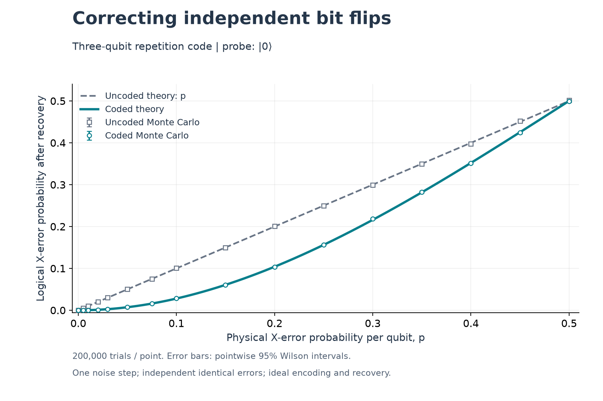
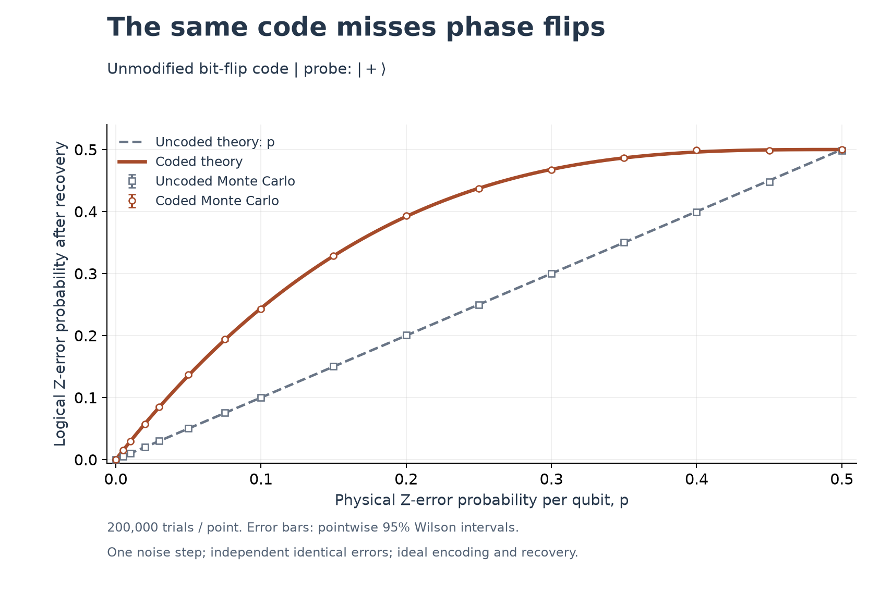

# Three-qubit error correction: what it fixes and what it misses

A reproducible educational study of the three-qubit bit-flip repetition code,
combining Monte Carlo experiments with an independent quantum-state calculation.

**Main result:** under independent X errors with physical error probability
`p = 0.10`, ideal recovery reduces the logical X-error probability to `0.028`.
Under independent Z errors at the same `p`, the unmodified code instead has a
logical Z-error probability of `0.244`.

This reproduces a standard model for learning and portfolio demonstration.
The repository makes no claim of a new error-correction method or a hardware
experiment.

**Start here:** [generated results](results/summary.md) ·
[raw data](results/performance.csv) ·
[Türkçe öğrenme rehberi](docs/LEARNING_GUIDE_TR.md)

## Research question

How much does the three-qubit repetition code suppress independent bit flips,
and what happens when exactly the same recovery is applied to phase flips?

## Results



The ideal X-error model predicts

$$p_{L,X} = 3p^2(1-p) + p^3.$$

Majority recovery fails for two or three X errors. It suppresses the logical
X-error probability for `0 < p < 0.5`. The crossing at `p = 0.5` belongs to this
ideal one-step model; it is not a circuit-level fault-tolerance threshold.



Z errors leave the parity syndrome unchanged. An odd number produces a logical
Z operation, giving

$$p_{L,Z} = 3p(1-p)^2 + p^3.$$

The phase experiment uses the **same bit-flip code**, without changing to a
phase-flip encoding. For `0 < p < 0.5`, its logical Z-error probability exceeds
the uncoded value `p`. A `|+>` probe makes phase errors observable; measuring only
`|0>` in the computational basis would hide them. These standard properties are
explained in [IBM Quantum's repetition-code lesson][ibm].

The committed run uses **200,000 trials per probability and noise type**,
16 probabilities, and seed `20261031`: 6.4 million coded trials, plus an equal
number of independent uncoded baseline trials. Markers are simulated estimates;
lines are analytical predictions. Error bars are pointwise 95% Wilson intervals.
Some error bars are smaller than the markers. Actual counts and intervals are
in [the generated table](results/summary.md).

## Method and assumptions

1. Encode `alpha|0> + beta|1>` as `alpha|000> + beta|111>`.
2. Apply one noise step, with independent identical errors on the three qubits.
   X-only and Z-only noise are separate experiments.
3. Measure the ideal parity checks `Z0 Z1` and `Z1 Z2`; apply the X correction
   selected by their two-bit syndrome, then decode.
4. Estimate logical-error probabilities by sampling physical error masks.
5. Independently enumerate all eight error masks using complex state vectors,
   projective syndrome measurements, and density matrices. Compare the exact
   quantum output against the analytical prediction.

Encoding, recovery, decoding, and syndrome measurements are noiseless. There are
no correlated errors, gate errors, readout errors, repeated rounds, leakage, or
hardware calibration data. The uncoded baseline uses the same physical error
probability and noise duration, with one physical qubit instead of three.

For X-only noise, the effective channel is
`rho -> (1 - p_L,X) rho + p_L,X X rho X`; the Z-only channel has the analogous
form. The plotted rate equals infidelity for the chosen probes (`|0>` for X,
`|+>` for Z). It is not the infidelity of every possible input state.

The quantum calculation models ideal ancilla parity measurements through their
data-qubit projectors; it does not explicitly simulate ancilla gate circuits.
It retains coherence within each syndrome branch. Tests include complex
superpositions, so verification goes beyond a classical majority-vote experiment.

## Reproduce

Use **Python 3.12** (the tested interpreter). No quantum hardware account is needed.
Run these commands from the repository root:

```bash
python3.12 -m venv .venv
source .venv/bin/activate
python -m pip install -r requirements.txt
python -m unittest discover -s tests -v
python -m qec_study
```

On Windows, activate with `.venv\Scripts\Activate.ps1` in PowerShell instead.
The last command regenerates the CSV, metadata, results summary, and PNG/SVG
figures. To run a different experiment without overwriting the committed outputs:

```bash
python -m qec_study --shots 500000 --seed 17 --output alternate-run
```

The seed, probability grid, trial count, and software versions are recorded in
[`metadata.json`](results/metadata.json). A fixed seed supports repeatability
in a matching environment; NumPy does not promise identical streams across all
versions and platforms ([NumPy compatibility policy][numpy]).

GitHub Actions runs the checks, regenerates the study, and compares the raw error
counts with the committed data. Platform metadata and figure bytes can differ.

## Code map and validation

| File | Purpose |
|---|---|
| [`model.py`](qec_study/model.py) | Quantum encoding, syndrome projectors, recovery, exact channels |
| [`experiment.py`](qec_study/experiment.py) | Error sampling, Wilson intervals, CSV and summary generation |
| [`plotting.py`](qec_study/plotting.py) | Two figures, each exported as PNG and SVG |
| [`tests/`](tests) | Complete error-pattern checks, coherence, channels, and estimation |

Validation checks every X and Z error pattern on five input states, including
`|+>`, `|+i>`, and an unequal complex superposition. Further checks cover density
matrix validity, theoretical channels, deterministic endpoints, a published
Wilson-interval example, and a fixed-seed Monte Carlo sanity check. A 95% interval
is not required to contain the theoretical value in every trial or sweep point.

## Sources and provenance

- [IBM Quantum: Repetition codes][ibm] — encoding, ideal recovery, and standard
  X/Z logical-error formulas.
- [Astropy: Binomial confidence intervals][wilson] — Wilson score construction.
- [RWTH Aachen: DS Python appendix, B4.1][rwth] — independent numerical interval
  example used in the tests.
- [NumPy random compatibility policy][numpy] — reproducibility limits.

The Python implementation does not copy the linked tutorials' code. The formulas
and recovery protocol are established material. Future investigations could add
imperfect syndrome measurements or correlated errors, which require a different
model.

MIT license; see [LICENSE](LICENSE).

[ibm]: https://quantum.cloud.ibm.com/learning/en/courses/foundations-of-quantum-error-correction/correcting-quantum-errors/repetition-codes
[wilson]: https://docs.astropy.org/en/stable/api/astropy.stats.binom_conf_interval.html
[rwth]: https://stat4ds.rwth-aachen.de/pdf/DS_Python_webAppendix.pdf
[numpy]: https://numpy.org/doc/stable/reference/random/compatibility.html
